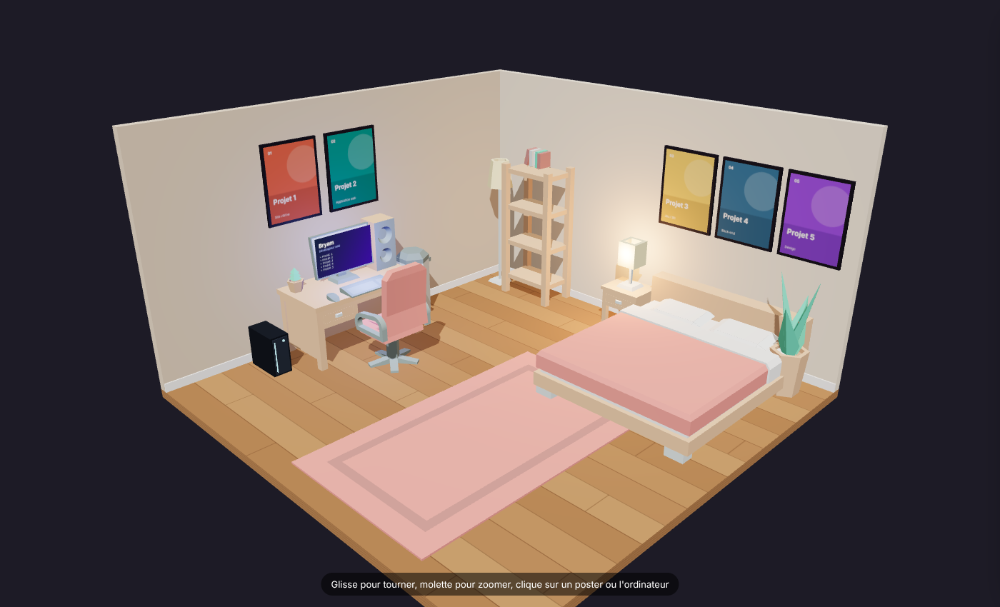
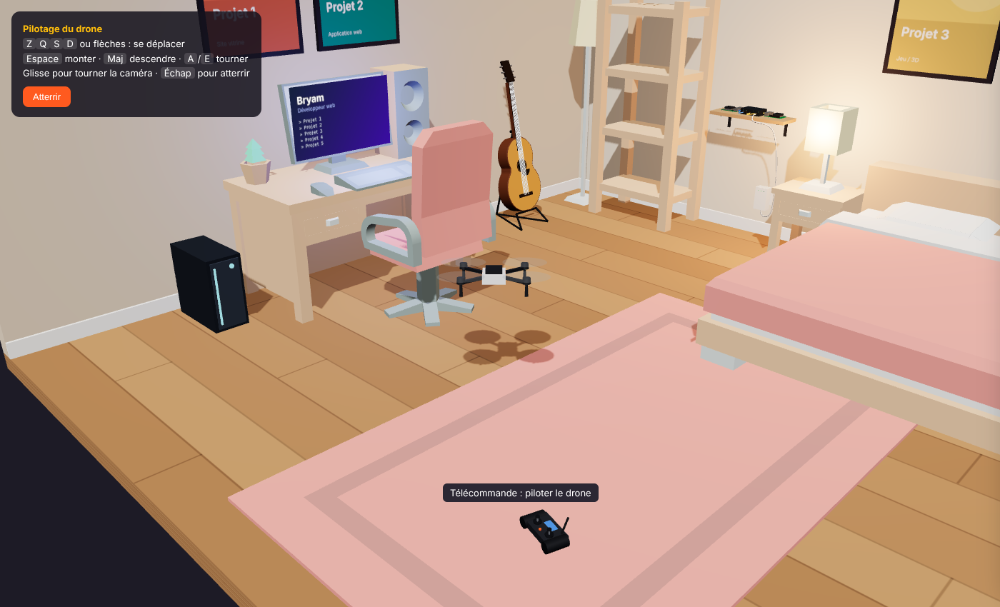
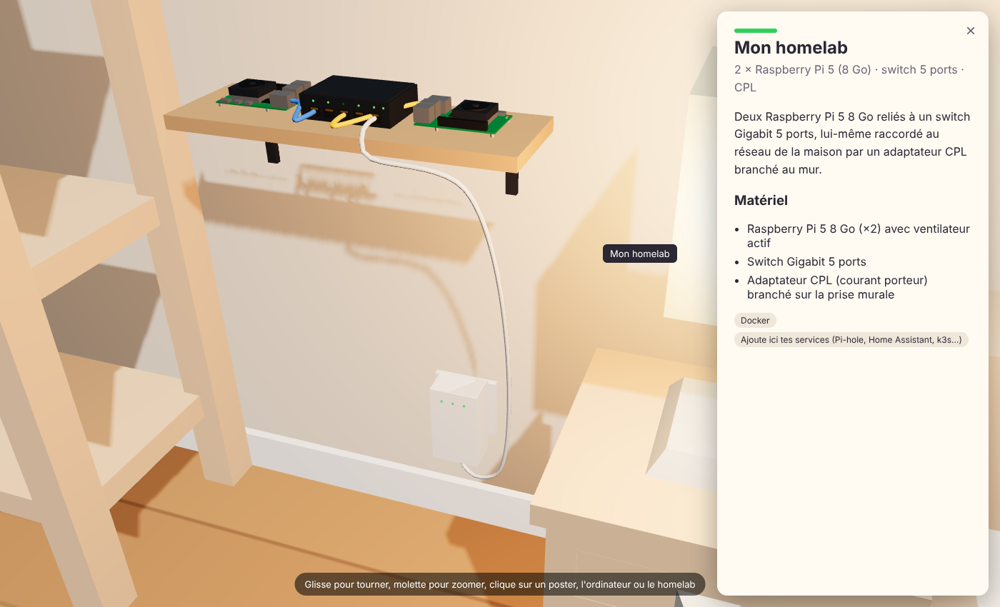
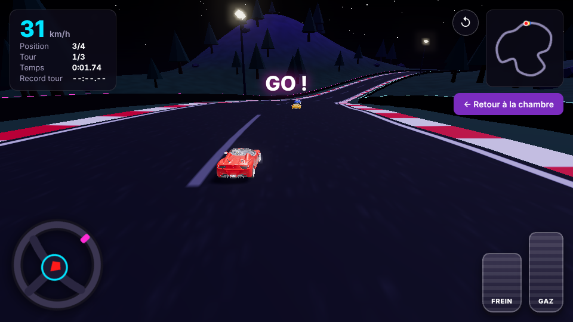

# Chambre virtuelle (Three.js + Kenney Furniture Kit)

Une chambre 3D interactive pour présenter tes projets : 5 posters cliquables (un par projet),
un écran et une tour de PC qui ouvrent une fiche « à propos », et ton homelab
(2 Raspberry Pi 5, switch 5 ports, CPL au mur) sur une étagère : clique dessus pour zoomer.
La guitare ouvre ton TikTok (lien dans `TIKTOK`, `projects.js`).

## Piloter le drone
Clique sur la télécommande posée sur le tapis (ou sur le drone) pour décoller :
- `Z Q S D` (ou `W A S D`) / flèches : se déplacer, par rapport à la caméra
- `Espace` monter, `Maj` ou `C` descendre, `A` / `E` tourner
- `Échap`, le bouton « Atterrir » ou un nouveau clic sur la télécommande : atterrir
- Sur mobile : joystick à gauche, boutons ▲ ▼ à droite

Le drone ne traverse ni les murs ni les meubles.

## Lancer
Les modules ES ne marchent pas en ouvrant le fichier directement (file://). Lance un petit serveur dans ce dossier :

    npx serve .
    # ou : python3 -m http.server 8000

puis ouvre l'adresse affichée. Dans VS Code, l'extension Live Server fait la même chose.

## Personnaliser
- `projects.js` : ton nom, ta présentation, tes liens, tes 5 projets (titre, description, tags, lien, couleur, image optionnelle) et la fiche du homelab (`HOMELAB`).
- `main.js` : `buildFurniture()` place les meubles (positions en mètres), `buildPosters()` place les posters.
- `models/` : modèles GLB du Kenney Furniture Kit. Le kit complet (140 meubles) : https://kenney.nl/assets/furniture-kit

## Course RC
Clique sur la voiture RC posée dans la chambre pour lancer une course (`circuit.html`) :
piste de course de nuit avec vibreurs, murets, tribune et projecteurs. Course de 3 tours contre 3 Ferrari
pilotées par l'ordinateur (bleue, jaune, verte), départ aux feux, position en direct, mini-carte et classement à l'arrivée.
- Volant, pédale de frein et pédale d'accélérateur à l'écran (souris ou doigt) : tourne le volant en le faisant glisser
- Au clavier : `Z` / `↑` accélérer, `S` / `↓` freiner et reculer, `Q` `D` / `←` `→` tourner
- `Espace` frein à main, `R` (ou ↺) remettre sur la piste, `C` changer de caméra, `Échap` retour à la chambre
Le meilleur tour est gardé dans le navigateur. Le niveau des adversaires se règle dans `DRIVERS` (`skill`) de `circuit.js`.

## Couleurs
`theme.js` contient deux thèmes : `gaming` (par défaut : murs sombres, néons violet/cyan, bloom) et `classique` (bois clair).
Change `ACTIVE` pour basculer, ou modifie les couleurs : murs, sol, matériaux des meubles (`materials`),
couleurs propres à un modèle (`models`, ex. le lit ou la chaise), néons, lumières et panneau d'infos.

## Structure
- `index.html` : page + styles
- `main.js` : scène Three.js
- `theme.js` : couleurs, néons et éclairage
- `circuit.html` / `circuit.js` : circuit RC (terrain, piste, sauts, physique, chrono)
- `rccar.js` : voiture RC
- `drone.js` : drone, télécommande et contrôleur de vol (clavier, tactile, collisions)
- `guitar.js` : guitare folk et son support, en primitives Three.js
- `homelab.js` : Raspberry Pi 5, switch, CPL et câbles, modélisés en primitives Three.js (appareils agrandis ×1,6 pour rester lisibles)
- `lib/` : Three.js r169 (copie locale, aucune dépendance CDN)

## Licences
- Modèles 3D : Kenney Furniture Kit, CC0 (domaine public, crédit facultatif), https://kenney.nl
- Voiture RC : Ferrari 458 Italia par vicent091036, reprise de l'exemple three.js « webgl_materials_car » (https://threejs.org/examples/webgl_materials_car.html), avec ses matériaux. Licence d'origine à vérifier avant un usage commercial.
- Three.js : MIT
